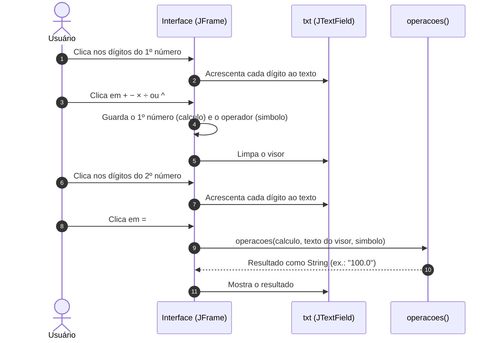
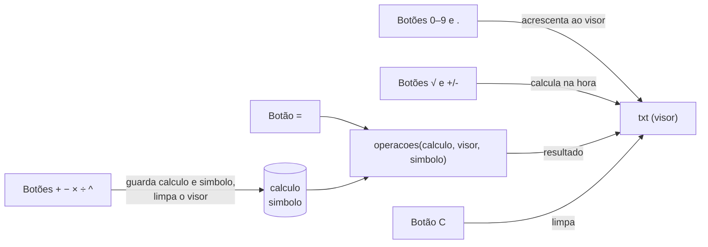

# 🧮 Calculator Desktop — Calculadora em Java Swing


> Uma calculadora de mesa com visual próprio, feita em Java Swing no editor visual do NetBeans.

O **Calculator Desktop** é o meu primeiro projeto em **Java**: uma calculadora com interface gráfica em **Swing**, montada no editor de formulários do **NetBeans** (projeto Ant, compilado para **Java 8**). Ela faz as quatro operações, potência, raiz quadrada e troca de sinal, numa janela sem bordas do sistema, com botões desenhados por imagens e barra de título própria.



---

## ✨ O Problema

Como primeiro projeto em Java, a ideia era sair do "Hello, World" no terminal e construir algo visual e utilizável: uma calculadora de mesa que respondesse a cliques, com uma aparência diferente da padrão do Swing.

## 🚀 A Solução

Uma única janela Swing (`Interface`, um `JFrame`) com:

- **Visor** (`JTextField`) onde os dígitos são montados e o resultado aparece.
- **Teclado de 20 botões** em grade 4 × 5: dígitos, ponto decimal, limpar, as quatro operações, potência, raiz quadrada, troca de sinal e igual.
- **Barra de título própria**: a janela não tem decoração do sistema; fechar e minimizar são dois botões de imagem no topo.

## 🎯 Diferenciais

- **Visual personalizado**: botões sem borda nem fundo, desenhados por imagens PNG, com troca de imagem ao passar o mouse e ao clicar.
- **Janela sem bordas** (`setUndecorated(true)`), centralizada na tela e com ícone próprio.
- **Sem dependências além do layout do NetBeans**: só a biblioteca padrão do Java e o `AbsoluteLayout` gerado pelo editor visual.

---

## 🛠️ Stack Tecnológica

| Camada | Tecnologia |
|---|---|
| **Linguagem** | Java 8 (`javac.source` e `javac.target` = `1.8` em `nbproject/project.properties`) |
| **Interface** | Swing, look and feel Nimbus |
| **Layout** | `org.netbeans.lib.awtextra.AbsoluteLayout` (biblioteca *Absolute Layout* do NetBeans, fora do JDK) |
| **Build** | Ant, via `build.xml` gerado pelo NetBeans |
| **IDE** | NetBeans 12.3 (formulário `Interface.form`); há também um módulo do IntelliJ IDEA (`CALCULADORA.iml`) |

---

## 🏛️ Arquitetura

Todo o programa está em uma classe, `calculadora.Interface`. O código de montagem da tela (`initComponents()`) foi gerado pelo editor visual do NetBeans a partir do `Interface.form`; a lógica fica nos tratadores de clique de cada botão e no método estático `operacoes()`.



| Classe | Responsabilidade | Métodos principais |
| :--- | :--- | :--- |
| `Interface` (`extends JFrame`) | Janela, visor, botões e cálculos | `main()`, `initComponents()`, `operacoes()`, um `...ActionPerformed()` por botão, `setIcon()` |

Estado guardado entre cliques: `calculo` (1º operando, texto), `simbolo` (operador) e `resultado` (2º operando, texto).

---

## 🧮 Funcionalidades

### Operações binárias (operador + `=`)

| Botão | `simbolo` | Cálculo em `operacoes()` |
| :---: | :---: | :--- |
| `+` | `+` | $a + b$ |
| `-` | `-` | $a - b$ |
| `×` | `*` | $a \times b$ |
| `÷` | `/` | $a \div b$ |
| `^` | `x^y` | $a^b$ (`Math.pow`) |

Os textos do visor são convertidos com `Double.parseDouble` e o resultado volta ao visor com `Double.toString`, então sempre aparece com casa decimal (`45 + 55` resulta em `100.0`).

### Operações imediatas (sobre o número do visor)

| Botão | Efeito |
| :---: | :--- |
| `√` | Substitui o número por $\sqrt{x}$ (`Math.sqrt`) |
| `+/-` | Substitui o número por $-x$ |

### Entrada e regras

- **Dígitos `0`–`9`**: são acrescentados ao final do texto do visor.
- **Ponto `.`**: com o visor vazio escreve `0.`; se o texto já tem ponto, o clique é ignorado.
- **Operadores, `√`, `+/-` e `=`** só agem se o visor não estiver vazio.
- **`C`** apaga o visor (não apaga o operador nem o 1º número guardados).
- **Uma operação por vez**: o operador guarda o número do visor como 1º operando. Clicar em outro operador antes do `=` troca o 1º operando pelo número atual.
- **`=` repetido** reaplica a mesma operação com o 1º operando guardado: `2 + 3 =` mostra `5.0`; um novo `=` calcula `2 + 5.0` e mostra `7.0`.

---

## 🖥️ Interface (Telas)

A aplicação tem uma única janela, de 330 × 590 px, sem bordas do sistema, não redimensionável e aberta no centro da tela, com o título "Calculadora" e o ícone `Icone.png`.


| Região | Componentes |
| :--- | :--- |
| **Topo** (fundo RGB 33, 43, 65) | Botões de 10 × 10 px no canto superior esquerdo: fechar (`Fechar.png`, fecha a janela) e minimizar (`MINIZAR.png`); visor `JTextField` com fonte Tahoma 40, texto branco alinhado à direita |
| **Teclado** (fundo RGB 46, 57, 81) | 20 botões de 70 × 70 px. Operadores e funções usam a imagem `BOTAOESPECIAL.png`, dígitos e ponto usam `BOTAO-NUMERICO.png`; cada um troca para a versão `...PRESS.png` ao passar o mouse e ao clicar |

Disposição do teclado:

| | | | |
| :---: | :---: | :---: | :---: |
| `C` | `^` | `√` | `×` |
| `7` | `8` | `9` | `÷` |
| `4` | `5` | `6` | `+` |
| `1` | `2` | `3` | `-` |
| `0` | `.` | `=` | `+/-` |

> A captura de tela não corresponde exatamente ao código atual: ela mostra uma linha com a expressão (`45 + 55`) acima do resultado, o resultado sem casa decimal (`100`) e os botões de janela no canto superior direito. No código há só um visor (o operador limpa o texto), o resultado sai como `100.0` e os botões ficam no canto superior esquerdo.

---

## 📁 Estrutura do Projeto

```text
calculator-desktop/
├── Calculadora/
│   └── CALCULADORA/
│       ├── CALCULADORA.iml              # Módulo do IntelliJ IDEA
│       ├── out/production/CALCULADORA/  # Saída do IntelliJ versionada (só as imagens)
│       └── calculadora/                 # Projeto NetBeans (Ant)
│           ├── build.xml
│           ├── manifest.mf
│           ├── nbproject/               # Configuração do NetBeans (inclui private/)
│           ├── build/classes/           # Classes compiladas versionadas
│           └── src/
│               ├── calculadora/
│               │   ├── Interface.java   # Janela, botões e cálculos
│               │   ├── Interface.form   # Formulário do editor visual do NetBeans
│               │   └── Icone.png        # Ícone da janela
│               └── botoes/              # Imagens dos botões (normal e pressionado)
├── imgGit/
│   └── Calculador.png                   # Captura de tela usada neste README
├── LICENSE
└── README.md
```

---

## ⚡ Quick Start

### Pré-requisitos
- JDK 8 ou superior.
- O JAR do **Absolute Layout** do NetBeans (`org.netbeans.lib.awtextra`), que não faz parte do JDK. O NetBeans já traz essa biblioteca; fora dele, baixe do Maven Central (`org.netbeans.external:AbsoluteLayout`).

### 1. Clonar o repositório
```bash
git clone https://github.com/matheusnascimentods/calculator-desktop.git
cd calculator-desktop/Calculadora/CALCULADORA/calculadora
```

### 2. Executar

**No NetBeans:** *File → Open Project*, selecione a pasta `Calculadora/CALCULADORA/calculadora` e use *Run Project* (F6). A classe principal é `calculadora.Interface`.

**Pelo terminal (Linux/macOS):**
```bash
# Baixar o Absolute Layout
mkdir -p lib
curl -L -o lib/AbsoluteLayout.jar \
  https://repo1.maven.org/maven2/org/netbeans/external/AbsoluteLayout/RELEASE160/AbsoluteLayout-RELEASE160.jar

# Compilar para Java 8
javac --release 8 -cp lib/AbsoluteLayout.jar -d out src/calculadora/Interface.java

# Executar (src/ entra no classpath para as imagens serem encontradas)
java -cp out:src:lib/AbsoluteLayout.jar calculadora.Interface
```

No Windows, troque `:` por `;` no classpath. Com JDK 8, use `-source 8 -target 8` no lugar de `--release 8`.

---

## 💻 Comandos Úteis

```bash
# Compilar
javac --release 8 -cp lib/AbsoluteLayout.jar -d out src/calculadora/Interface.java

# Executar
java -cp out:src:lib/AbsoluteLayout.jar calculadora.Interface

# Gerar dist/calculadora.jar com o Ant do NetBeans (fora do IDE é preciso informar a biblioteca)
ant -Dlibs.absolutelayout.classpath=lib/AbsoluteLayout.jar jar

# Conferir a versão do Java
java -version
```

---

## 🎓 Contexto

Projeto pessoal de estudo e meu primeiro projeto em Java. Apesar de simples, o foco foi a interface gráfica: montar uma janela interativa no editor visual do NetBeans, com botões personalizados por imagens.

---

## 🔒 Boas Práticas & Limitações

- **Sem dados externos**: nada é lido ou gravado em disco; tudo acontece em memória.
- **Recursos no classpath**: imagens carregadas com `getClass().getResource(...)`, sem caminhos absolutos no código.

### Limitações conhecidas
- **Dependência fora do JDK**: o layout usa `AbsoluteLayout` do NetBeans; sem esse JAR o código não compila. O módulo do IntelliJ (`CALCULADORA.iml`) não declara essa biblioteca.
- **Sem validação de entrada**: o visor é um campo editável, então dá para digitar texto qualquer; nesse caso o cálculo lança `NumberFormatException`. Clicar em `=` sem ter escolhido um operador lança `NullPointerException` (o erro aparece só no console e o visor não muda).
- **Casos numéricos**: divisão por zero mostra `Infinity` (ou `NaN` em `0 ÷ 0`) e raiz de número negativo mostra `NaN`. Resultados seguem o `double`, com notação científica em números grandes (`1.0E10`) e imprecisões como `0.1 + 0.2 = 0.30000000000000004`.
- **Fluxo de cálculo limitado**: uma operação por vez, sem precedência nem expressão visível; `C` não limpa o operador guardado; depois de um resultado, novos dígitos são acrescentados a ele (`5.0` seguido de `1` vira `5.01`).
- **Teclado físico**: não há atalhos de teclado; Enter no visor não calcula.
- **Janela fixa**: sem a barra do sistema e sem tratamento de arraste, a janela não pode ser movida.
- **Código morto**: um segundo botão `.` (`BTNPONTO1`) sobreposto ao primeiro e sem ação, `jButton5` nunca adicionado à tela, `jDesktopPane1` e `jPanel3` vazios, campo `ponto` nunca lido e as imagens `BOTAOESPECIALLARGE*.png` sem uso.
- **Artefatos versionados**: `build/classes/`, `out/production/` e `nbproject/private/` (com caminhos absolutos de uma máquina Windows) estão no repositório, e não há `.gitignore`.
- **Fonte fixa**: o visor e os botões usam Tahoma, que pode ser substituída por outra fonte em sistemas que não a têm.
- **Sem testes automatizados.**

---

## 🤝 Contribuindo

1. Faça um Fork do projeto
2. Crie uma branch para a sua funcionalidade (`git checkout -b feature/nome-da-feature`)
3. Faça o commit das suas alterações (`git commit -m 'feat: implementa nova funcionalidade'`)
4. Envie para o repositório remoto (`git push origin feature/nome-da-feature`)
5. Abra um **Pull Request** detalhando as alterações

---

## 📄 Licença

Distribuído sob a licença MIT. Veja [`LICENSE`](LICENSE) para mais detalhes.

---
Feito com ❤️ por [@matheusnascimentods](https://github.com/matheusnascimentods)
